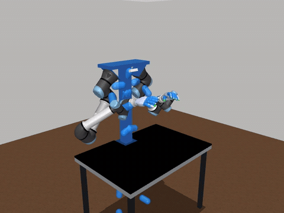
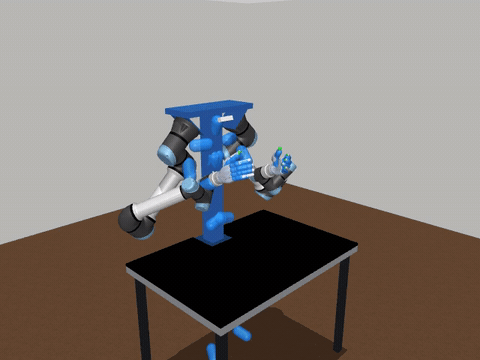
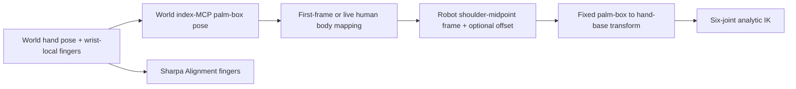
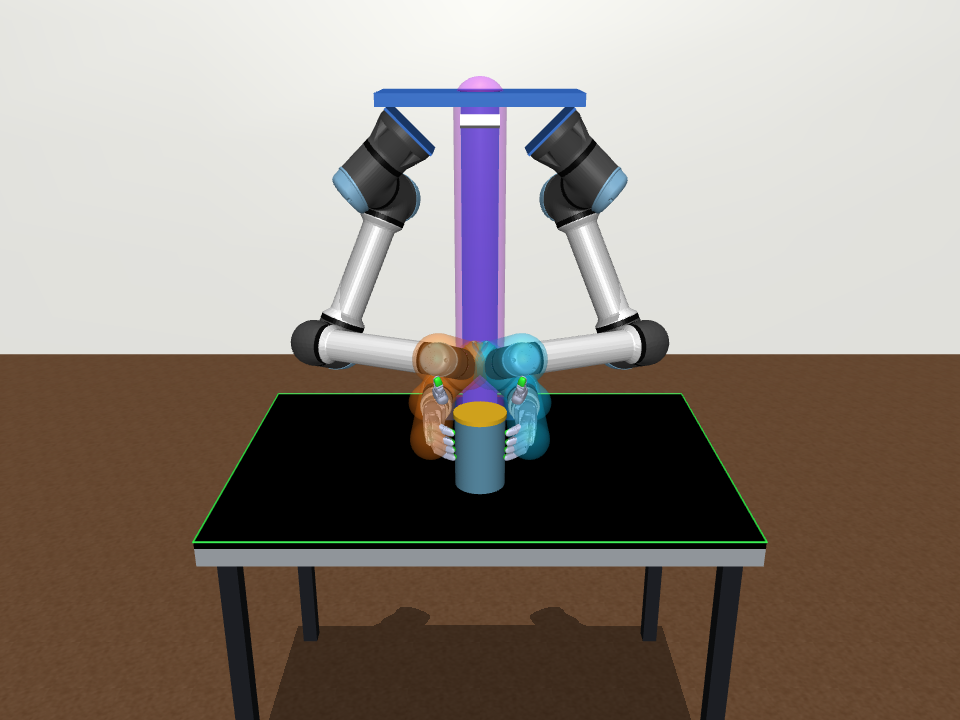

# Dexterous UR gantry teleoperation

## Shared Python dependencies

`geo_kin_core` and `xrt_devices` now come from versioned PyPI wheels, not Git
submodules. The tested versions for this checkout are:

```bash
python -m pip install "eurola-geo-kin-core==0.1.2" "eurola-xrt-devices==0.1.2"
```

For an existing editable installation, run `python -m pip uninstall geo-kin-core xrt-devices`
before installing the renamed packages, or use `uv sync` to reconcile the lockfile.

Normal project installation (`uv sync` or `pip install` with the project and its
local robot/simulator dependencies) selects these versions automatically. Imports
and the `geo-kin-provision` command are unchanged. Other robot, simulator, and
hardware submodules remain where needed; `--recurse-submodules` below is for those.
The private `geo_kin` solver and its license are still supplied separately.

For shared-library development, explicitly install matching source checkouts with
`python -m pip install -e /path/to/geo_kin_core -e /path/to/XRT_devices` and run the
venv's Python directly. A subsequent `uv sync` restores the released packages.


| Picking up mustard | Ip Man |
|:---:|:---:|
|  |  |
| [MP4 video](docs/media/picking_up_mustard.mp4) | [MP4 video](docs/media/ipman_roll.mp4) |

Full recordings at original speed · kinematic replay · human overlay enabled.

Bimanual UR7e EEF retargeting with Sharpa Wave or Wuji finger alignment, using the exact
[urgantry_sim](https://github.com/kczttm/urgantry_sim) model. The licensed Rust
`geo_kin` wheel solves six arm joints per side from hand orientation and index-MCP
position. Human elbows are not an arm objective. Full finger landmarks drive hand-specific Alignment solvers. The gantry stays fixed; collision avoidance
is not implemented.

## Setup and replay

```bash
git submodule update --init --recursive
uv sync
uv run gantry-viz                 # Sharpa preview, no license needed
uv run gantry-viz --hand wuji      # Wuji preview
```

Register the supplied organization wheel and signed license (replace the bundle
path with your extracted distribution):

```bash
uv run geo-kin-provision register --product urgantry-sharpa \
  --wheel /path/to/cmu-iam/geo_kin-0.1.0-cp310-abi3-manylinux_2_35_x86_64.whl \
  --license /path/to/cmu-iam/geo_kin_license.toml \
  --name cmu-iam-urgantry --replace
export GEO_KIN_LICENSE="$HOME/.config/geo-kin/licenses/cmu-iam-urgantry.toml"
uv run geo-kin-provision install
uv run gantry-teleop --sample ipman_roll
uv run gantry-teleop --sample ipman_roll --loop
uv run gantry-teleop --sample picking_up_mustard --headless
```

The environment variable selects this license without changing the global active
license. The wheel requires Linux x86-64, glibc 2.35+, and CPython 3.10+.
`--replace` allows updating an older wheel with the same versioned filename.

Replay exits and closes the window after one pass by default. `--loop` repeats
the recording, resetting the robot, hand state, body anchor and optional offset
at each boundary. `--steps N` caps total updates across all passes. Close the
window or press Ctrl+C to stop.

The viewer sets joint positions from named position targets and calls
`mj_forward`, never `mj_step`. Both side panels start hidden. The default camera uses a front three-quarter
view like OpenArm, rotated for the gantry and centered on the upper body and
hands (azimuth 225°, elevation −18°, distance 2.4 m). **R** recenters the
teleop mapping at the current arm configuration; in `gantry-viz`, **R** resets the
model home pose. `gantry-viz --show-ui` exposes actuator sliders. Replay shows a translucent blue human skeleton, including fingers and legs
when recorded, aligned with the same body mapping and optional EEF offset. Use
`--no-human-overlay` to hide it. Recenter also resets the overlay alignment.
Live-device human overlays and goal-frame overlays are not yet provided.

## Selecting Wuji

Sharpa remains the default. Use `--hand wuji` for both 20-joint Wuji hands:

```bash
uv run gantry-teleop --hand wuji --sample picking_up_mustard --loop
uv run gantry-teleop --hand wuji --sample ipman_roll --loop
uv run --extra devices gantry-teleop --hand wuji --device xr
uv run gantry-generate --hand wuji
```

The wheel must include `wuji` and the signed license must grant it. The updated
CMU IAM bundle enables `urgantry`, `sharpa` and `wuji`, with the original
2027-10-14 expiry. Re-register the updated bundle with `--replace` and reinstall
as above. Both hand variants run from that same wheel; the existing project
provisioning product remains `urgantry-sharpa`. A Wuji-specific environment can
register the wheel as `urgantry-wuji` instead.

`scene_wuji.xml` has 52 position actuators: 6 arm + 20 hand per side. Its geometry
comes from the pinned simulator's Wuji v1.0.2 model. Named sites mark the model's
authored tip-link origins. The separate model signature includes these sites
and explicit position controls; the original simulator submodule is unchanged.

Wuji uses the same index-MCP palm-box EEF target and body alignment. Its new
hand solver aligns thumb CMC→MCP→IP→tip and finger MCP→PIP→DIP→tip directions.
SP2 seeds the proximal joint pair, a small bounded analytic-Jacobian refinement
accounts for its offset axes, and SP1 solves the distal joints. Each hand emits
20 angles with model limits; missing fingers retain previous commands. The
six-joint arm IK is unchanged. No hand position-matching mode is provided.

The video exporter accepts `--hand wuji`; it writes suffixed filenames without
overwriting the Sharpa README previews:

```bash
uv run python scripts/render_replays.py --hand wuji --output docs/media
```

## Input and alignment

```bash
uv sync --extra devices
uv run --extra devices gantry-teleop --device xr --alignment first_frame
uv sync --extra mediapipe
uv run gantry-teleop --device mediapipe --alignment shoulder_attached
```

Run `gantry-teleop --help` for host, port, camera, rate and frame-file options.
Live headset/camera acquisition has not been exercised in this implementation;
input conversion is covered by fixture tests.

`first_frame` captures the first valid engaged human upper-body pose. Later body
motion remains part of the arm targets. `shoulder_attached` instead maps targets
relative to the live human body. Both modes default to **no positional offset**. `--offset` optionally computes
one shared initial translation from the human index MCPs and the current robot
palms, then holds it fixed until reset. `--no-offset` explicitly selects the
default. Translation scale is 1 metre/metre. Only offset-enabled calibration
needs both targets.
Afterward, each arm can update independently. Missing body tracking holds both.



Each robot shoulder is the intersection of joint axes h1/h2. The robot upper-body
origin is their midpoint: `[0, -0.3825, 1.37974159]` in simulator world metres.
Its +x points toward world +y, +y toward world -x, and +z upward. The TCP is the
fixed index-MCP palm-box origin, not the flange or a moving finger link.
The EEF input carries world position/rotation, body world pose, and optional
wrist-local finger landmarks. Legacy recordings supply wrist orientation and
finger data through an adapter; their elbow values are ignored. The legacy
three-point finger payload omits DIP and thumb CMC landmarks. These are recovered
from the recorded full skeleton in wrist coordinates; measured MCP/PIP/TIP
values are preserved. Live XR now supplies these additional joints as well.
A legacy file without those skeleton joints cannot recover the missing data.

## Solver and model provenance

The private `geo-kin-ur-gantry` Rust crate uses existing `geo-kin-subproblems`
and Sharpa Alignment code. Arm and mounted Wave hand geometry are extracted
from this scene, including the side-specific adapters. Older HA4 geometry is
not substituted. Palm forward axes are checked against the wrist-to-MCP
direction, correcting the Wave right hand's opposite flexion-axis convention. Arm joint limits are disabled by default for this kinematic preview. Each
verified IK branch is lifted by whole turns to the closest feedback/previous
configuration; the minimum joint-distance candidate is selected. Use
`--arm-joint-limits` to enforce the model limits. Finger limits remain enabled.
The low-level wheel selects this with `arm_ik_limited=False`; its API default
remains limited for compatibility. Every returned arm branch is checked by FK at a 1e-6 metre and
rotation-matrix Frobenius residual threshold. Unreachable or unverified targets
hold the affected arm; diagnostics report status through `solution_branch`.

IK follows the pinned IK-Geo three-parallel decomposition. This UR model also
has intersecting wrist axes 5/6, making the general SP6 setup rank deficient.
The actual model therefore uses the upstream `three_parallel_two_intersecting`
SP4/SP4 initialization, followed by SP1, SP3, SP1 and the remaining parallel
joint angle. There is no numerical Jacobian fallback or elbow-angle target.

Simulator revision: `46a784ac2cb59080205e722d91084bb244195092`.
Generated XML: `dex_ur_gantry_teleop/assets/scene_sharpa.xml`, with 56 explicit
position actuators and the upstream home keyframe. Mesh paths reference the
simulator submodule, which must remain available. `gantry-generate` regenerates
the XML. Teleop checks its SHA-256 against the wheel's model signature and
rejects mismatches. The historical `universal_robots_ur5e` asset directory
contains the supplied UR7e model. Asset licenses remain in the submodule.

## Validation and limitations

- Rust: 400 random reachable arm targets, 200 upstream branch-set comparisons,
  session reset/alignment checks, existing seven Sharpa tests, and eight Python
  binding license/banner tests passed.
- Current application suite: 17 tests, including both complete recordings,
  MuJoCo arm/hand FK, recovered distal landmarks, reset, both body modes,
  unrestricted multi-turn seeds, simulator clipping and invalid inputs.
- With no offset and the corrected right palm frame, both complete recordings
  accept every arm target: `ipman_roll` 601/601 per arm and
  `picking_up_mustard` 844/844 per arm (including the repeated endpoint). All
  accepted EEF poses match FK within 1e-6. Earlier right-arm hold results were
  caused by the palm-frame bug and are superseded by this validation.
- Nearest-branch selection minimizes joint distance; it is not a velocity limiter.
  `ipman_roll` still contains large joint changes near singular configurations.
  These kinematic commands are not a hardware trajectory controller.
- Wuji: 200 random mounted arm/hand FK cases match MuJoCo; 80 synthetic
  articulated hand poses verify all segment directions. Both complete replays
  accept every arm target, with finite bounded 20-joint hand commands.
- Live devices, dynamic simulation and hardware have not been validated.
  No continuous offset adaptation or collision filter is supplied.

To run the licensed application tests:

```bash
uv sync --extra test
uv run geo-kin-provision install
uv run pytest
```

## References and citation

This application builds on the SEW-Mimic / `geo_kin` retargeting framework.
The six-joint gantry arms use EEF-only IK; the SEW-Mimic paper describes the
related upper-body orientation-alignment method.

Chuizheng Kong et al., **A Closed-Form Geometric Retargeting Solver for Upper
Body Humanoid Robot Teleoperation** (SEW-Mimic), 2026.
[Paper](https://arxiv.org/abs/2602.01632) · [Project](https://sew-mimic.com/).

```bibtex
@misc{kong2026sewmimic,
  title = {A Closed-Form Geometric Retargeting Solver for Upper Body Humanoid Robot Teleoperation},
  author = {Chuizheng Kong and Yunho Cho and Wonsuhk Jung and Idris Wibowo and
            Parth Shinde and Sundhar Vinodh-Sangeetha and Long Kiu Chung and
            Zhenyang Chen and Andrew Mattei and Advaith Nidumukkala and
            Alexander Elias and Danfei Xu and Taylor Higgins and Shreyas Kousik},
  year = {2026},
  eprint = {2602.01632},
  archivePrefix = {arXiv},
  primaryClass = {cs.RO},
  url = {https://arxiv.org/abs/2602.01632}
}
```

Arm inverse-kinematics reference:

Alexander J. Elias and John T. Wen, **IK-Geo: Unified robot inverse kinematics
using subproblem decomposition**, *Mechanism and Machine Theory* 209, 105971
(2025). [Paper](https://doi.org/10.1016/j.mechmachtheory.2025.105971),
[preprint](https://arxiv.org/abs/2211.05737),
[pinned implementation](https://github.com/rpiRobotics/ik-geo/blob/a3a1675e1f01ad6f8f15f2cc787fa01472082a11/rust/src/inverse_kinematics/mod.rs#L253).
Adapted IK orchestration retains BSD-3-Clause attribution in the wheel's
`THIRD_PARTY_LICENSES`. Shared input/simulation remains in this public app and
its submodules; the licensed solver is distributed separately.

### Manual workspace translation

Use `--workspace-offset X Y Z` to shift both hand targets by a fixed translation
in meters in the robot shoulder-midpoint frame: **+X forward, +Y left, +Z up**.
For example, move the workspace 5 cm forward and 10 cm up:

```bash
uv run gantry-teleop --hand wuji --sample picking_up_mustard --loop --workspace-offset 0.05 0 0.10
```

The default is `0 0 0`. This works with either alignment mode and either hand.
It adds to automatic initial calibration if `--offset` is also supplied; without
that flag it is the only workspace translation. Hand orientations and relative
hand placement are preserved. The human overlay uses the same translation.
Reset/recenter and replay loops preserve the manual value while recalibrating
the optional automatic offset. Large shifts can make targets unreachable.

The updated wheel exposes the same setting:

```python
session = geo_kin.RetargetSession(
    robot="urgantry", hand="wuji", functional_offset=False,
    workspace_offset=(0.05, 0.0, 0.10), arm_ik_limited=False,
    collision_avoidance=False,
)
```

Older wheels must be upgraded to accept `workspace_offset`.

### Interactive IK branch previews

```bash
uv run python scripts/preview_bimanual_table.py
```

The bimanual preview starts with symmetric Sharpa hands around a visual jar,
wrists up and elbows outward, matching the symmetric cup-holding baseline. Click the MuJoCo window, then use **Left/Right**
to cycle the left arm and **Down/Up** to cycle the right arm. Each arm has eight
FK-validated solutions for this fixed target; the terminal prints branch numbers.
All branches preserve the hand targets, but some may intersect the scene.
Changes snap between static configurations; this is not a trajectory planner or
a contact/dynamics grasp simulation. The jar is a visual reference.

The licensed wheel must support `urgantry` and `sharpa`. If needed, set
`GEO_KIN_LICENSE` to your gantry-enabled license before running.

For the earlier single-arm comparison:

```bash
uv run python scripts/preview_wrist_up.py
```

Keys **1/2/3** select original, wrist-up/elbow-inward, and wrist-up/elbow-outward.
Both scripts accept `--render OUTPUT_DIRECTORY` to save images and pose reports;
use `MUJOCO_GL=egl` when rendering without a display.

### Rust XPBD wrist safety

Use the updated gantry wheel and enable the safety filter explicitly:

```bash
uv run gantry-teleop --hand sharpa --sample picking_up_mustard --loop --safety-filter
uv run --extra devices gantry-teleop --hand wuji --device xr --safety-filter
```

MediaPipe uses `--device mediapipe`. Offline replay also accepts `--headless`.
Keep the existing `--workspace-offset X Y Z` and `--offset` options as needed.
The filter is disabled unless `--safety-filter` is supplied. The older wheel
must be replaced with the rebuilt wheel that accepts these constructor options.

Edit [`dex_ur_gantry_teleop/assets/safety_capsules.json`](dex_ur_gantry_teleop/assets/safety_capsules.json)
and restart teleop to change geometry without rebuilding Rust. To keep variants:

```bash
uv run gantry-teleop --safety-filter --safety-config /path/to/my_capsules.json
```

The `sharpa` and `wuji` lists each have three independently adjustable capsules:

- `palm_wrist`: attached to `wrist_3_link`, endpoints `[0,-0.025,0]` to `[0,0.27144,0]` for Sharpa or `[0,0.2665,0]` for Wuji.
- `wrist_bend`: attached to `wrist_2_link`, endpoints `[0,0,-0.025]` to `[0,0,0.14]`.
- `wrist_connector`: attached to `wrist_1_link`, endpoints `[0,-0.030,0]` to `[0,0.127,0]`, radius 0.060 m. Its elbow-side endpoint extends past the wrist-1 joint to cover the forearm connection; its wrist-side endpoint stops at the wrist-2 joint, overlapping `wrist_bend`.
- The palm and bend capsules retain radius 0.045 m; the connector uses 0.060 m to cover its larger measured cross-section.

Endpoints are in the named link's local frame; lengths, radii and margins are
meters. The palm capsule follows the local Y axis; the bend follows local Z, and the connector follows local Y.
Fingertips intentionally protrude. These are configurable approximations, not
certified mesh envelopes. The default obstacles are a horizontal table
half-space at world Z=0.775 m and a column capsule. The table constraint also
applies outside the tabletop footprint. The overlay uses the exact world-space
capsules returned by Rust, so geometry is not reconstructed in Python.

`solver` controls clearance margin (1 mm by default), XPBD compliance, iteration count,
joint correction limits, joint velocity (rad/s), hand-base position/orientation
correction limits (meters/radians), and joint-path sampling step (radians).
Corrections happen inside Rust `RetargetSession.solve`, after analytic IK and
before returning commands. Rust uses shared collision primitives, exact segment
distance and analytic joint Jacobians. No Python/MuJoCo projection loop runs in
teleop. Joint rate limiting also applies to otherwise clear targets while this
filter is enabled, so fast recordings may lag the requested pose.

The filter makes a local correction, does not search alternate IK branches,
and rejects an elbow/wrist sign flip introduced by projection. Blocked goals or
excessive corrections hold the affected arm and hand. An already penetrating
initial pose is rejected rather than labeled safe. Recenter/loop reset clears
per-frame diagnostics but retains the configuration. Console diagnostics report
`clear`, `rate_limited`, `corrected`, and hold reasons. The arm capsule overlay is
automatic whenever safety is enabled, including with `--no-human-overlay`.

This protects only the configured wrist/palm capsules against table/column.
It does not check fingertips, elbows, the rest of the arms, inter-arm collision,
the jar or other objects. Joint-path clearance is sampled, not a continuous
collision proof. This implementation is for the kinematic simulator; hardware
has not been validated.

Direct wheel use (JSON text, not a filename):

```python
from pathlib import Path
import geo_kin
session = geo_kin.RetargetSession(
    robot="urgantry", hand="sharpa", functional_offset=False,
    arm_ik_limited=False, collision_avoidance=False,
    safety_filter=True, control_rate_hz=60,
    safety_config=Path("dex_ur_gantry_teleop/assets/safety_capsules.json").read_text(),
)
# session.solve(frame, q_current_left=..., q_current_right=...)
# session.safety_state contains capsules, obstacles, and correction reports.
```

Inspect dimensions in the branch viewer using the same file:

```bash
uv run python scripts/preview_bimanual_table.py --capsules \
  --safety-config dex_ur_gantry_teleop/assets/safety_capsules.json
```

The branch viewer displays Rust geometry but intentionally does not filter the
arrow-key-selected branches. Use teleop for enabled correction.


### Fixed wrist branch and tighter clearance

Choose the branch at startup:

```bash
uv run --extra devices gantry-teleop --hand sharpa --device xr --safety-filter --wrist-branch wrist_up
uv run gantry-teleop --hand wuji --sample picking_up_mustard --loop --safety-filter --wrist-branch wrist_down
```

`wrist_up` is the symmetric cup-holding preview branch; `wrist_down` is the
previous teleop default. Teleop and the replay renderer now default to `wrist_up`. This choice is immutable for
that session. Rust fixes the shoulder/elbow root signs as well as the selected
wrist flip. Missing/singular solutions hold with `selected_branch_unavailable`;
there is no fallback to another root. Reset, recenter, and replay loops preserve
the choice. Teleop initializes the simulator in an equivalent home hand pose
on the chosen branch, before tracking starts. Feedback from another branch
holds with `feedback_branch_mismatch`; it does not silently change the lock.
The names describe the wrist flip relative to the reference cup pose; they are
not an absolute height guarantee for every possible hand orientation.

The Python constructor accepts `wrist_branch="wrist_up"` or `"wrist_down"`;
pass `wrist_branch="wrist_up"` explicitly when calling the wheel directly (its compatibility default remains down). `session.wrist_branch` is read-only. The low-level `eef_ik` diagnostic and arrow-key
branch viewer still inspect all analytic roots; they do not change the branch
used by `session.solve` or the safety command filter.

Edit `assets/safety_capsules.json` inside the Python package:

- `table.margin`: extra clearance from the capsule surface to the tabletop,
  now **0.001 m (1 mm)**.
- `column.margin`: extra clearance to the column capsule, also **0.001 m**.
- `solver.margin`: fallback for older/custom configs that omit either margin.
- `radius`: each protected capsule's radius, currently **0.045 m**; its 5 mm
  padding above the model's nominal 40 mm wrist radius is separate from the
  extra obstacle margin.
- `table.height`: physical tabletop world height; keep this at the measured
  surface rather than changing it to tune clearance.
- `column.radius`: physical conservative column envelope; the square column's
  circumscribed capsule is wider than its flat sides. A small clearance margin
  does not remove that geometric conservatism.

For example, set `table.margin` to `0.0005` for 0.5 mm, and leave `column.margin`
at `0.001` for 1 mm. Nonnegative margins are accepted; do not increase
`solver.tolerance` to bypass the clearance check. Changes apply on restart.

The main capsule centerline now reaches the **extended middle-finger PIP**
(271.44 mm along final-wrist local Y for Sharpa, 266.5 mm for Wuji), and extends
25 mm rearward. The rounded end adds the radius beyond each endpoint. The bend
capsule extends from -25 mm to +140 mm on wrist-2 local Z. Fingers can still
protrude; these dimensions follow the neutral extended hand rather than dynamic
finger joint positions. Inspect edits with the capsule preview before replay.

### Upgrade a stale provisioned wheel

A `TypeError` for `workspace_offset`, `safety_filter`, or `wrist_branch` means
the loaded binary is too old; a source checkout update alone cannot add these
wheel APIs. In particular, SHA-256
`3394a7eee371ddf29be673c779c3d027dab7545b63c6d15b2dad6d348bc793e3`
is the October 16 CMU IAM build and does not support `workspace_offset`.

Obtain the updated wheel bundle from your EuRoLa distributor. Private wheels and
organization licenses are not included in this Git repository. The current build
must support `wrist_1_link`: older XPBD wheels reject the new three-capsule config.
Use your organization's license (it must cover `urgantry` and your selected hand).

Stop running teleop/Python processes, extract the bundle, and run from this repo:

```bash
git pull --ff-only
git submodule update --init --recursive
uv sync
export BUNDLE=/absolute/path/to/extracted/bundle
export GEO_KIN_LICENSE="$BUNDLE/geo_kin_license.toml"
uv run geo-kin-provision register --product urgantry-sharpa --replace \
  --wheel "$BUNDLE/geo_kin-0.1.0-cp310-abi3-manylinux_2_35_x86_64.whl" \
  --license "$GEO_KIN_LICENSE" --activate
uv run geo-kin-provision install
uv run python "$BUNDLE/verify_install.py"
uv run gantry-teleop --hand wuji --sample picking_up_mustard --safety-filter
```

The verifier checks both hands, both fixed wrist branches, workspace offsets and
**six total capsules** (three per arm). To keep XR dependencies installed, use
`uv run --extra devices gantry-teleop --device xr --safety-filter` for live input.

This repo's provision product is `urgantry-sharpa`; the combined wheel contains
**both Sharpa and Wuji**, so `--hand wuji` uses the same installation. If another
project explicitly uses product `urgantry-wuji`, register it under that product
as well. `--replace` is required because the wheel filename/version is unchanged.
The bundle verifier checks the installed binary hash and the new APIs. Restart
running Python/teleop processes after replacing the shared installation.

## Egocentric hand recordings

Four clips from [ego_retarget](https://github.com/Ingenio17/ego_retarget) are available under `recordings/ego_retarget`: OakInk2 bottle-unscrewing and EgoVerse stitching, sewing, and appliance repair. See the [branch study](docs/EGO_BRANCH_STUDY.md) for replay commands, the wrist-up/down comparison with Rust safety enabled, and the virtual body/table calibration assumptions.

### Current wrist protection

Three overlapping capsules per arm cover the palm/wrist, the wrist bend, and the
next short link toward the elbow. `wrist_connector` uses local endpoints
`[0,-0.030,0]` and `[0,0.127,0]`, radius `0.060` m: extended toward the forearm
connection and shortened on the hand side. Edit the JSON and restart teleop to
apply adjustments. Wrist-up is the application default and stays locked.


