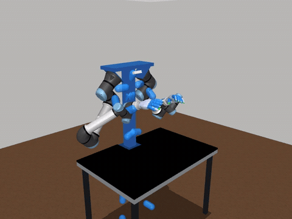
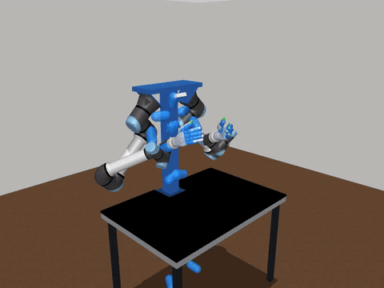
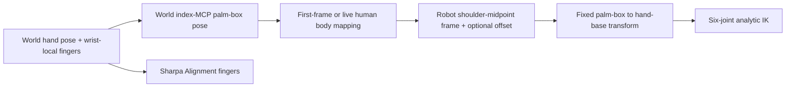

# Dexterous UR gantry teleoperation

| Picking up mustard | Ip Man |
|:---:|:---:|
|  |  |
| [MP4 video](docs/media/picking_up_mustard.mp4) | [MP4 video](docs/media/ipman_roll.mp4) |

Full recordings at original speed · kinematic replay · human overlay enabled.

Bimanual UR7e EEF retargeting with Sharpa Wave or Wuji finger alignment, using the exact
[urgantry_sim](https://github.com/kczttm/urgantry_sim) model. The licensed Rust
`geo_kin` wheel solves six arm joints per side from hand orientation and index-MCP
position. Human elbows are not an arm objective. Full finger landmarks drive hand-specific Alignment solvers. The gantry stays fixed; collision avoidance
is not implemented.

## Setup and replay

```bash
git submodule update --init --recursive
uv sync
uv run gantry-viz                 # Sharpa preview, no license needed
uv run gantry-viz --hand wuji      # Wuji preview
```

Register the supplied organization wheel and signed license (replace the bundle
path with your extracted distribution):

```bash
uv run geo-kin-provision register --product urgantry-sharpa \
  --wheel /path/to/cmu-iam/geo_kin-0.1.0-cp310-abi3-manylinux_2_35_x86_64.whl \
  --license /path/to/cmu-iam/geo_kin_license.toml \
  --name cmu-iam-urgantry --replace
export GEO_KIN_LICENSE="$HOME/.config/geo-kin/licenses/cmu-iam-urgantry.toml"
uv run geo-kin-provision install
uv run gantry-teleop --sample ipman_roll
uv run gantry-teleop --sample ipman_roll --loop
uv run gantry-teleop --sample picking_up_mustard --headless
```

The environment variable selects this license without changing the global active
license. The wheel requires Linux x86-64, glibc 2.35+, and CPython 3.10+.
`--replace` allows updating an older wheel with the same versioned filename.

Replay exits and closes the window after one pass by default. `--loop` repeats
the recording, resetting the robot, hand state, body anchor and optional offset
at each boundary. `--steps N` caps total updates across all passes. Close the
window or press Ctrl+C to stop.

The viewer sets joint positions from named position targets and calls
`mj_forward`, never `mj_step`. Both side panels start hidden. The default camera uses a front three-quarter
view like OpenArm, rotated for the gantry and centered on the upper body and
hands (azimuth 225°, elevation −18°, distance 2.4 m). **R** recenters the
teleop mapping at the current arm configuration; in `gantry-viz`, **R** resets the
model home pose. `gantry-viz --show-ui` exposes actuator sliders. Replay shows a translucent blue human skeleton, including fingers and legs
when recorded, aligned with the same body mapping and optional EEF offset. Use
`--no-human-overlay` to hide it. Recenter also resets the overlay alignment.
Live-device human overlays and goal-frame overlays are not yet provided.

## Selecting Wuji

Sharpa remains the default. Use `--hand wuji` for both 20-joint Wuji hands:

```bash
uv run gantry-teleop --hand wuji --sample picking_up_mustard --loop
uv run gantry-teleop --hand wuji --sample ipman_roll --loop
uv run gantry-teleop --hand wuji --device xr
uv run gantry-generate --hand wuji
```

The wheel must include `wuji` and the signed license must grant it. The updated
CMU IAM bundle enables `urgantry`, `sharpa` and `wuji`, with the original
2027-10-14 expiry. Re-register the updated bundle with `--replace` and reinstall
as above. Both hand variants run from that same wheel; the existing project
provisioning product remains `urgantry-sharpa`. A Wuji-specific environment can
register the wheel as `urgantry-wuji` instead.

`scene_wuji.xml` has 52 position actuators: 6 arm + 20 hand per side. Its geometry
comes from the pinned simulator's Wuji v1.0.2 model. Named sites mark the model's
authored tip-link origins. The separate model signature includes these sites
and explicit position controls; the original simulator submodule is unchanged.

Wuji uses the same index-MCP palm-box EEF target and body alignment. Its new
hand solver aligns thumb CMC→MCP→IP→tip and finger MCP→PIP→DIP→tip directions.
SP2 seeds the proximal joint pair, a small bounded analytic-Jacobian refinement
accounts for its offset axes, and SP1 solves the distal joints. Each hand emits
20 angles with model limits; missing fingers retain previous commands. The
six-joint arm IK is unchanged. No hand position-matching mode is provided.

The video exporter accepts `--hand wuji`; it writes suffixed filenames without
overwriting the Sharpa README previews:

```bash
uv run python scripts/render_replays.py --hand wuji --output docs/media
```

## Input and alignment

```bash
uv sync --extra devices
uv run gantry-teleop --device xr --alignment first_frame
uv sync --extra mediapipe
uv run gantry-teleop --device mediapipe --alignment shoulder_attached
```

Run `gantry-teleop --help` for host, port, camera, rate and frame-file options.
Live headset/camera acquisition has not been exercised in this implementation;
input conversion is covered by fixture tests.

`first_frame` captures the first valid engaged human upper-body pose. Later body
motion remains part of the arm targets. `shoulder_attached` instead maps targets
relative to the live human body. Both modes default to **no positional offset**. `--offset` optionally computes
one shared initial translation from the human index MCPs and the current robot
palms, then holds it fixed until reset. `--no-offset` explicitly selects the
default. Translation scale is 1 metre/metre. Only offset-enabled calibration
needs both targets.
Afterward, each arm can update independently. Missing body tracking holds both.



Each robot shoulder is the intersection of joint axes h1/h2. The robot upper-body
origin is their midpoint: `[0, -0.3825, 1.37974159]` in simulator world metres.
Its +x points toward world +y, +y toward world -x, and +z upward. The TCP is the
fixed index-MCP palm-box origin, not the flange or a moving finger link.
The EEF input carries world position/rotation, body world pose, and optional
wrist-local finger landmarks. Legacy recordings supply wrist orientation and
finger data through an adapter; their elbow values are ignored. The legacy
three-point finger payload omits DIP and thumb CMC landmarks. These are recovered
from the recorded full skeleton in wrist coordinates; measured MCP/PIP/TIP
values are preserved. Live XR now supplies these additional joints as well.
A legacy file without those skeleton joints cannot recover the missing data.

## Solver and model provenance

The private `geo-kin-ur-gantry` Rust crate uses existing `geo-kin-subproblems`
and Sharpa Alignment code. Arm and mounted Wave hand geometry are extracted
from this scene, including the side-specific adapters. Older HA4 geometry is
not substituted. Palm forward axes are checked against the wrist-to-MCP
direction, correcting the Wave right hand's opposite flexion-axis convention. Arm joint limits are disabled by default for this kinematic preview. Each
verified IK branch is lifted by whole turns to the closest feedback/previous
configuration; the minimum joint-distance candidate is selected. Use
`--arm-joint-limits` to enforce the model limits. Finger limits remain enabled.
The low-level wheel selects this with `arm_ik_limited=False`; its API default
remains limited for compatibility. Every returned arm branch is checked by FK at a 1e-6 metre and
rotation-matrix Frobenius residual threshold. Unreachable or unverified targets
hold the affected arm; diagnostics report status through `solution_branch`.

IK follows the pinned IK-Geo three-parallel decomposition. This UR model also
has intersecting wrist axes 5/6, making the general SP6 setup rank deficient.
The actual model therefore uses the upstream `three_parallel_two_intersecting`
SP4/SP4 initialization, followed by SP1, SP3, SP1 and the remaining parallel
joint angle. There is no numerical Jacobian fallback or elbow-angle target.

Simulator revision: `46a784ac2cb59080205e722d91084bb244195092`.
Generated XML: `dex_ur_gantry_teleop/assets/scene_sharpa.xml`, with 56 explicit
position actuators and the upstream home keyframe. Mesh paths reference the
simulator submodule, which must remain available. `gantry-generate` regenerates
the XML. Teleop checks its SHA-256 against the wheel's model signature and
rejects mismatches. The historical `universal_robots_ur5e` asset directory
contains the supplied UR7e model. Asset licenses remain in the submodule.

## Validation and limitations

- Rust: 400 random reachable arm targets, 200 upstream branch-set comparisons,
  session reset/alignment checks, existing seven Sharpa tests, and eight Python
  binding license/banner tests passed.
- Current application suite: 17 tests, including both complete recordings,
  MuJoCo arm/hand FK, recovered distal landmarks, reset, both body modes,
  unrestricted multi-turn seeds, simulator clipping and invalid inputs.
- With no offset and the corrected right palm frame, both complete recordings
  accept every arm target: `ipman_roll` 601/601 per arm and
  `picking_up_mustard` 844/844 per arm (including the repeated endpoint). All
  accepted EEF poses match FK within 1e-6. Earlier right-arm hold results were
  caused by the palm-frame bug and are superseded by this validation.
- Nearest-branch selection minimizes joint distance; it is not a velocity limiter.
  `ipman_roll` still contains large joint changes near singular configurations.
  These kinematic commands are not a hardware trajectory controller.
- Wuji: 200 random mounted arm/hand FK cases match MuJoCo; 80 synthetic
  articulated hand poses verify all segment directions. Both complete replays
  accept every arm target, with finite bounded 20-joint hand commands.
- Live devices, dynamic simulation and hardware have not been validated.
  No continuous offset adaptation or collision filter is supplied.

To run the licensed application tests:

```bash
uv sync --extra test
uv run geo-kin-provision install
uv run pytest
```

## References and citation

This application builds on the SEW-Mimic / `geo_kin` retargeting framework.
The six-joint gantry arms use EEF-only IK; the SEW-Mimic paper describes the
related upper-body orientation-alignment method.

Chuizheng Kong et al., **A Closed-Form Geometric Retargeting Solver for Upper
Body Humanoid Robot Teleoperation** (SEW-Mimic), 2026.
[Paper](https://arxiv.org/abs/2602.01632) · [Project](https://sew-mimic.com/).

```bibtex
@misc{kong2026sewmimic,
  title = {A Closed-Form Geometric Retargeting Solver for Upper Body Humanoid Robot Teleoperation},
  author = {Chuizheng Kong and Yunho Cho and Wonsuhk Jung and Idris Wibowo and
            Parth Shinde and Sundhar Vinodh-Sangeetha and Long Kiu Chung and
            Zhenyang Chen and Andrew Mattei and Advaith Nidumukkala and
            Alexander Elias and Danfei Xu and Taylor Higgins and Shreyas Kousik},
  year = {2026},
  eprint = {2602.01632},
  archivePrefix = {arXiv},
  primaryClass = {cs.RO},
  url = {https://arxiv.org/abs/2602.01632}
}
```

Arm inverse-kinematics reference:

Alexander J. Elias and John T. Wen, **IK-Geo: Unified robot inverse kinematics
using subproblem decomposition**, *Mechanism and Machine Theory* 209, 105971
(2025). [Paper](https://doi.org/10.1016/j.mechmachtheory.2025.105971),
[preprint](https://arxiv.org/abs/2211.05737),
[pinned implementation](https://github.com/rpiRobotics/ik-geo/blob/a3a1675e1f01ad6f8f15f2cc787fa01472082a11/rust/src/inverse_kinematics/mod.rs#L253).
Adapted IK orchestration retains BSD-3-Clause attribution in the wheel's
`THIRD_PARTY_LICENSES`. Shared input/simulation remains in this public app and
its submodules; the licensed solver is distributed separately.
